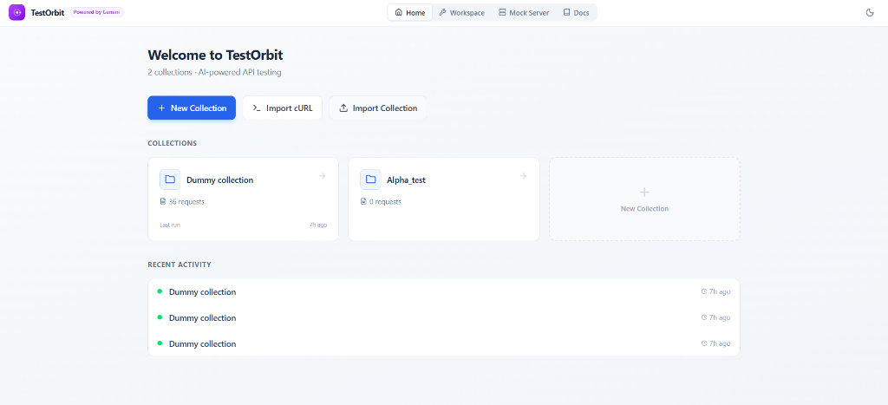
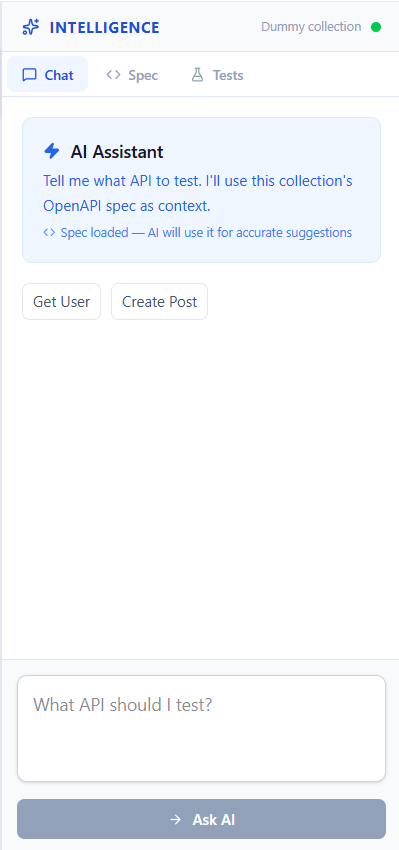
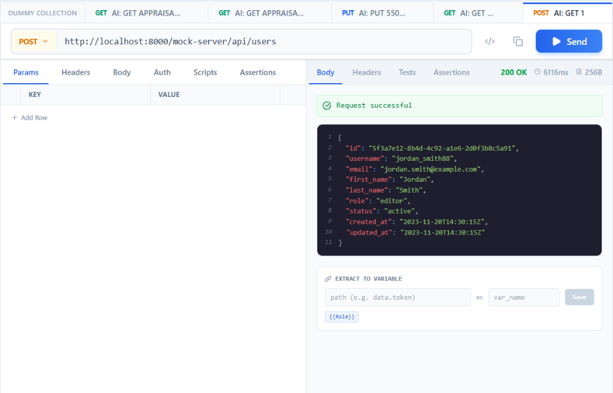
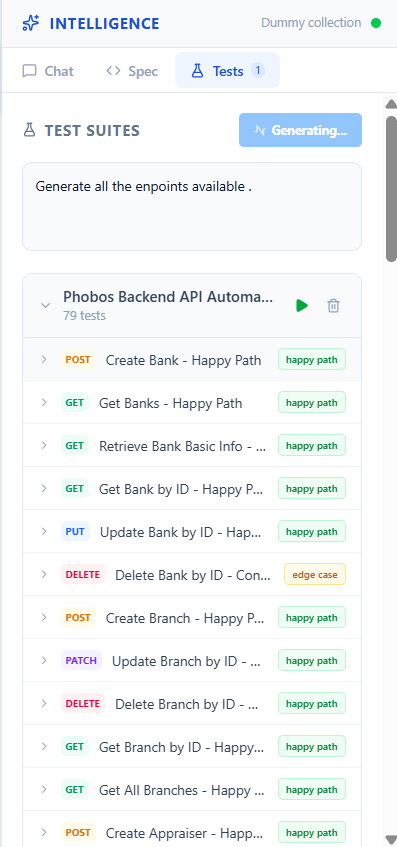

<div align="center">
  

  # TestOrbit

  ### The fast, affordable, AI-powered Postman alternative

  **Unlimited AI. Free for teams. No bloat.**

  [](https://github.com/R-Praneshkumar/Test_Orbit_Prod/actions/workflows/ci.yml)
  [](https://testorbit.dev)
  [](https://react.dev/)
  [](https://fastapi.tiangolo.com/)
  [](LICENSE)
  [](CONTRIBUTING.md)

  [Get Started](#-quick-start) · [Why TestOrbit?](#-why-testorbit) · [Features](#-features) · [Migrate from Postman](#-migrate-from-postman) · [Deploy](#-deployment)

</div>

---

## Why TestOrbit?

Postman v12 (March 2026) gutted the free plan — **1 user only, 50 AI credits/month, ₹1,600/user/month for teams**. TestOrbit is what we built instead.

<table>
<tr>
<td width="50%">

### TestOrbit gives you
- **50 AI calls/day free** (30x more than Postman)
- **Free for teams of 3** (Postman: 1 user)
- **Unlimited AI on paid plans** (no credits, no meters)
- **AI security scanning** (OWASP Top 10 — Postman doesn't have this)
- **₹399/month Pro** (Postman: ₹1,600/month)
- **Web-first** — opens instantly in any browser, no install required

</td>
<td width="50%">

### Honest trade-offs
- No GraphQL/gRPC/MQTT (yet)
- No Postman Monitors (scheduled runs)
- No enterprise SSO/governance
- Smaller ecosystem and community
- No 70-tool AI agent mode

**Use Postman if you need enterprise features. Use TestOrbit if you want fast, affordable AI testing.**

</td>
</tr>
</table>

---

## TestOrbit vs Postman

| Feature | TestOrbit | Postman |
|---------|:---------:|:-------:|
| **Free plan team size** | **3 users** | 1 user |
| **AI calls (free)** | **50/day** | 50/month |
| **AI calls (paid)** | **Unlimited** | Metered credits |
| **Pro price (solo)** | **₹399/mo** | ₹1,600/mo |
| **5-person team/year** | **₹28,740** | ₹1,05,570 |
| **AI security scanning** | **Yes** | No |
| **AI test generation** | Yes | Yes |
| **AI code generation** | Yes | Yes |
| **WebSocket testing** | Yes | Yes |
| **Collection runner** | Yes | Yes |
| **Mock server** | Yes | Yes |
| **Import from Postman** | Yes | Native |
| **AI security scanning** | **Yes** (OWASP Top 10) | No |
| **GraphQL/gRPC** | No (planned) | Yes |
| **Enterprise SSO** | No (planned) | Yes |

---

## Features

### AI-Powered Testing

| Feature | What it does |
|---------|--------------|
| **AI Test Generation** | Generate boundary, negative, contract, and performance tests from any endpoint |
| **AI Security Scanning** | OWASP Top 10 detection — SQL injection, XSS, SSRF, auth bypass, IDOR |
| **AI Code Generation** | Export requests as Python, JavaScript, cURL, and more |
| **AI Diagnostics** | One-click root cause analysis on failed tests with suggested fixes |
| **AI Chat** | Describe what you want in plain English — AI builds the request |
| **AI Voice Input** | Speak your request, AI converts to API call |

### Complete Testing Suite

- **Collection Runner** — Sequential + parallel execution with AI optimization
- **Assertions Builder** — Visual builder for status, JSONPath, header, regex checks
- **Pre/Post Scripts** — Postman-compatible `pm.*` API in sandboxed JS
- **WebSocket Tester** — Connect, send messages, binary data support
- **Environment Variables** — Per-user key-value variables synced to cloud
- **Request History** — Searchable log with method/status/URL filters

### Import Everything

| Format | Supported |
|--------|:---------:|
| Postman Collections (v2.1) | Yes |
| Insomnia | Yes |
| OpenAPI / Swagger | Yes |
| Thunder Client | Yes |
| cURL Commands | Yes |

### Team & Collaboration

- **Google, GitHub, Email** sign-in via Supabase Auth
- **Cloud sync** — Collections synced across devices
- **Collection sharing** — Invite collaborators with viewer/editor/admin roles
- **Team workspaces** — Role-based access control
- **Weekly digest emails** — Automated usage summaries

### Developer Experience

- **Command Palette** — `Ctrl+K` to search requests, collections, and actions
- **Dark mode** — Full dark theme with purple accents
- **Keyboard shortcuts** — `Ctrl+Enter` to send, `Ctrl+N` for new request
- **Local mode** — Work fully offline without any cloud dependency
- **Export** — JUnit XML, HTML reports, Postman, OpenAPI formats

---

## Migrate from Postman

Migration takes under 5 minutes:

1. **Export from Postman** — Right-click collection → Export → Collection v2.1 JSON
2. **Import into TestOrbit** — Click "Import" in the sidebar → Drop your JSON file
3. **Done** — All requests, folders, scripts, environments, and auth configs transfer automatically

### What transfers

| Feature | Status |
|---------|:------:|
| Collections & folders | Fully supported |
| Request methods & headers | Fully supported |
| Request body (JSON, form, raw, binary) | Fully supported |
| Pre-request scripts | Fully supported |
| Test scripts & assertions | Fully supported |
| Environment variables | Fully supported |
| Collection auth (Bearer, Basic, API Key) | Fully supported |
| Insomnia exports | Fully supported |
| GraphQL queries | Planned |

---

## Demo

<div align="center">

**[Watch the Demo Video](https://vimeo.com/1163412339)**

</div>

### Screenshots

<table>
  <tr>
    <td align="center"><b>Dashboard</b></td>
    <td align="center"><b>AI Chat</b></td>
  </tr>
  <tr>
    <td></td>
    <td></td>
  </tr>
  <tr>
    <td align="center"><b>Mock Server</b></td>
    <td align="center"><b>Test Generation</b></td>
  </tr>
  <tr>
    <td></td>
    <td></td>
  </tr>
</table>

---

## Quick Start

### Prerequisites

- **Node.js** 18+ ([Download](https://nodejs.org/))
- **Python** 3.11+ ([Download](https://python.org/))
- **AI API Key** ([Get one free](https://aistudio.google.com/apikey))

### 1. Clone & Setup Backend

```bash
git clone https://github.com/R-Praneshkumar/TestOrbit.git
cd TestOrbit/backend

# Create virtual environment
python -m venv .venv
.venv\Scripts\activate      # Windows
source .venv/bin/activate    # macOS/Linux

# Install dependencies
pip install -r requirements.txt

# Configure environment
cp .env.example .env
# Edit .env and add: GEMINI_API_KEY=your_key_here

# Start server
uvicorn app.main:app --reload --port 8000
```

### 2. Setup Frontend

```bash
cd ../frontend
npm install

# (Optional) Configure Supabase for auth/sync
cp .env.example .env.local
# Edit .env.local with your Supabase credentials

npm run dev
```

### 3. Open TestOrbit

Open **http://localhost:5173** in your browser.

> TestOrbit works fully offline without Supabase — you just won't have auth, cloud sync, or sharing. All AI features work with just the AI API key.

---

## Pricing

| | Free | Pro | Team |
|-|:----:|:---:|:----:|
| **Price** | ₹0 | ₹399/mo | ₹799/mo + ₹399/seat |
| **Users** | 3 | 1 | Up to 25 |
| **AI calls** | 50/day | Unlimited | Unlimited |
| **AI security scans** | 3/day | Unlimited | Unlimited |
| **Collections** | Unlimited | Unlimited | Unlimited |
| **Team workspaces** | - | - | Yes |
| **Role-based access** | - | - | Yes |

---

## Deployment

**Recommended free stack: Cloudflare Pages (frontend) + Render (backend) = $0/month**

### Frontend (Cloudflare Pages)

1. Go to [dash.cloudflare.com](https://dash.cloudflare.com) → Workers & Pages → Create → Pages
2. Connect your GitHub repo
3. Set root directory: `frontend`, build command: `npm run build`, output: `dist`
4. Set env vars: `VITE_SUPABASE_URL`, `VITE_SUPABASE_ANON_KEY`, `VITE_API_BASE_URL`

### Backend (Render)

1. Go to [render.com](https://render.com) → New → Web Service
2. Connect your GitHub repo
3. Set root directory: `backend`, runtime: Docker, instance: Free
4. Set env vars: `GEMINI_API_KEY`, `ENV=production`, `REQUIRE_AUTH=True`, `SUPABASE_JWT_SECRET`, `ALLOWED_ORIGINS`

### Docker (Self-hosted)

```bash
cp backend/.env.example backend/.env
# Edit backend/.env with your keys

docker compose up --build -d
# Frontend: http://localhost  |  Backend: http://localhost:8000
```

See [DEVELOPER.md](DEVELOPER.md) for the full deployment guide, Supabase setup, and troubleshooting.

---

## Architecture

```
+-------------------+     HTTPS      +-------------------+     API      +-------------------+
|    Browser        | ──────────────> |    Frontend        | ──────────> |    Backend         |
|    (React SPA)    | <────────────── |    (Cloudflare)    | <────────── |    (Render)        |
+-------------------+                 +-------------------+             +-------------------+
        |                                      |                               |
        |   Supabase Auth (JWT)                |   authFetch()                 |   AI API
        v                                      v                               v
+-------------------+                                                 +-------------------+
|   Supabase        |                                                 |   AI    |
|   (Auth + DB)     |                                                 |   2.0 Flash        |
+-------------------+                                                 +-------------------+
```

### Tech Stack

| Layer | Technology | Version |
|-------|------------|---------|
| **Frontend** | React, Vite, Tailwind CSS | 19, 7, 4 |
| **State** | Zustand (persisted to localStorage) | 5.x |
| **Backend** | FastAPI, Python | 0.128+, 3.11+ |
| **AI** | AI Engine | via google-genai |
| **Auth & DB** | Supabase (RLS + JWT) | 2.x |
| **Payments** | Razorpay | INR billing |

---

## Security

- **JWT Authentication** — Supabase JWT validation on all API routes
- **SSRF Protection** — Blocks private IPs, cloud metadata, localhost
- **Rate Limiting** — Per-IP via slowapi (configurable per endpoint)
- **Input Validation** — Pydantic field limits (URLs: 2KB, specs: 100KB, bodies: 1MB)
- **Security Headers** — CSP, X-Frame-Options, HSTS, Permissions-Policy
- **Secret Masking** — API keys, JWTs, tokens masked in all log output
- **HTTPS Enforcement** — Auto-redirect in production
- **Structured Logging** — JSON logs with request IDs for observability

---

## API Reference

All endpoints require JWT auth when `REQUIRE_AUTH=True`. Rate limited per IP.

| Method | Endpoint | Description | Rate Limit |
|--------|----------|-------------|------------|
| `POST` | `/api/v1/generate` | AI test case generation | 10/min |
| `POST` | `/api/v1/suggest` | AI test suggestions | 10/min |
| `POST` | `/api/v1/run` | Batch test execution | — |
| `POST` | `/api/v1/voice` | Natural language to API request | 10/min |
| `POST` | `/api/v1/codegen` | Code snippet generation | 10/min |
| `POST` | `/api/v1/diagnose` | AI failure diagnosis | 10/min |
| `POST` | `/api/v1/security-scan` | AI security vulnerability scan | 10/min |
| `POST` | `/api/v1/proxy` | CORS proxy for external APIs | 60/min |
| `ANY` | `/mock-server/*` | AI mock response generation | 30/min |
| `GET` | `/api/v1/admin/stats` | Admin dashboard metrics | — |
| `GET` | `/api/v1/digest/preview` | Preview weekly digest email | — |
| `GET` | `/` | Health check | — |

---

## Contributing

We welcome contributions! See [CONTRIBUTING.md](CONTRIBUTING.md) for details.

```bash
git clone https://github.com/R-Praneshkumar/TestOrbit.git
git checkout -b feature/amazing-feature
# Make changes, then validate:
cd frontend && npm run lint   # Must be 0 errors, 0 warnings
cd frontend && npm run build  # Must succeed
cd backend && python -c "from app.main import app; print('OK')"
cd backend && python -m pytest tests/ -v  # All tests must pass
```

---

## License

MIT License — see [LICENSE](LICENSE) for details.

---

<div align="center">

  **[Developer Guide](DEVELOPER.md)** · **[Roadmap](todo.md)** · **[Contributing](CONTRIBUTING.md)** · **[Pricing](https://testorbit.dev)**

  Built with AI, React 19, and FastAPI

  [Back to Top](#testorbit)

</div>
